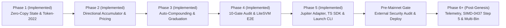

# Ratchet-DLMM-DAMM: Engineering Milestones & Post-Genesis Iteration Roadmap

> **Architecture**: Directional Dump-Brake Volatility Accumulator + $\sqrt{P}$ Market-Cap Fee Scheduler + OnlyB Quote Auto-Compounding & In-Place Graduation
> **Current Status**: Phases 1–5 implemented, with local tests passing (`programs/ratchet-dlmm-damm`, `tests/litesvm-e2e`, `audit-harness`, `sdk/jupiter-adapter`, `sdk/ts-client`). Still outstanding: the live Devnet rehearsal (`npm run devnet:e2e`, implemented but not yet run), a re-run of the `sdk/ts-client` tests after the 30-bin genesis calibration, an external security audit, and mainnet deployment.

---

## 1. Implementation Milestone Summary

| Phase | Primary Focus | Core Gates Exercised | Status & Verification Evidence |
| :--- | :--- | :--- | :--- |
| **Phase 1** | Zero-Copy State & Token-2022 Foundation | `G04`, `G05` | **Implemented** — `RatchetPoolPda` (`480 B` / `608 B`), `ActiveBinArrayPda` (`1,024 B` / `1,152 B`), SIMD-0437 Step 2/5 rent, `TransferFeeConfig` fallback |
| **Phase 2** | Directional Accumulator & Pricing Engine | `G01`, `G07`, `G08`, `G09` | **Implemented** — Q64.64 `u128` math, $\sqrt{P}_{\max}$ ratchet, $5\times$ dump-brake, `700 bps` sell impact cap |
| **Phase 3** | Quote Auto-Compounding & In-Place Graduation | `G01`, `G06`, `G10` | **Implemented** — `75%` OnlyB floor compounding, `0`-lamport drift, solvency check (`85.0 <= 86.5 SOL`), `0`-slot graduation |
| **Phase 4** | 10-Gate Verification & sBPF Compute Profiling | `G01`–`G10` | **Implemented** — `audit-harness` (`13` tests, `10/10` gates) + `tests/litesvm-e2e` on real `.so` (`35,069 CU <= 43,000 CU` budget) |
| **Phase 5** | Aggregator Integration, Client SDK & Launch CLI | `G02`, `G03`, `G05`, `G10` | **Implemented** — `sdk/jupiter-adapter` (`6` tests), `sdk/ts-client` (`mainnet:preflight` & `mainnet:launch`), `.so` compiled (`192,032 B`) |
| **Pre-Mainnet** | Independent Audit & Mainnet Genesis | All (`G01`–`G10`) | **Pending** — Third-party security audit, custom branding in `deploy/launch.config.json`, `solana program deploy` & `mainnet:launch` |
| **Phase 6+** | Telemetry, Rent Migration & Protocol Extensions | `G04`, `G05`, `G06`–`G10` | **Planned** — Next-cohort preset tuning, SIMD-0437 Step 2 $\to$ Step 5 migration, multi-bin-array extension hooks |

---

## 2. Implemented Engineering Phases (Phases 1–5)

### Phase 1: Zero-Copy State & Token-2022 Foundation
- **`RatchetPoolPda` (`480` data / `608` total bytes)** and **`ActiveBinArrayPda` (`1,024` data / `1,152` total bytes)** implemented as `#[repr(C)]` `bytemuck::Pod` + `Zeroable` structs in `programs/ratchet-dlmm-damm/src/state.rs`.
- On-chain Solana `processor.rs` uses unaligned `Pod` reads (`from_bytes_unaligned`) + slice writeback to avoid alignment faults on Solana's 8-byte-aligned account data buffers.
- Token-2022 `ExtensionType::TransferFeeConfig` write-lock-free fallback harvesting and SIMD-0437 rent calculators verified for Step 2 (`8,940,800 L`) and Step 5 (`1,224,960 L`).

### Phase 2: Directional Accumulator & Pricing Engine
- Checked `u128` Q64.64 and 256-bit widening helpers (`mul_u128_wide`, `mul_div_u128`, `div_ceil_u128`) in `programs/ratchet-dlmm-damm/src/math.rs`.
- Monotonic high-water buy fee ratchet (base fee $8000 \cdot \gamma^{n}$ bps with an asymptotic 25 bps floor; ≈2,259 bps at the +12 graduation step and ≈875 bps at the top seeded bin with γ = 0.9), separate $v_a^+$ / $v_a^-$ accumulators, $5\times$ asymmetric dump-brake ($f_{\text{sell}}(t) \le 2,500\text{ bps}$), and `700 bps` pre-swap single-leg sell impact cap.

### Phase 3: Quote Auto-Compounding & In-Place Graduation
- `75%` OnlyB quote auto-compounding (`compounding_fee_bps = 7500`) routing $\Delta R_{\text{sol, compounded}}$ into `floor_bin_id` in-instruction with `LHS == RHS` (`0` lamport drift) in `compounding.rs`.
- Vault solvency enforcement (`max_extractable_lamports <= real_vault_lamports`) and atomic in-place graduation (`graduation_status` `0 -> 1`, `dead_zone_slots = 0`) in `graduation.rs`.

### Phase 4: 10-Gate Verification & Real sBPF LiteSVM Suite
- `audit-harness`: `13` deterministic unit/fuzz tests (`10,000`-swap conservation fuzz + `5,000`-case `u128` overflow fuzz), `.so` ELF64 BPF & cross-repo `declare_id!` parity checks, generating `gate_verification_report.json` and `GATE_AUDIT_REPORT.md` (`10/10 PASS`).
- `tests/litesvm-e2e`: executes signed Solana transactions against the compiled `ratchet_dlmm_damm.so` (`192,032` bytes) and live SPL Token-2022 / SPL Token BPF programs, measuring peak Swap CU = `35,069 CU` (`<= 43,000 CU` budget).

### Phase 5: Aggregator Integration, Client SDK & Launch Tooling
- `sdk/jupiter-adapter`: Jupiter `Amm`-compatible Rust simulation crate (`6` tests including multi-wallet pump-and-dump cohort replay and 28-account swap meta resolution).
- `sdk/ts-client`: TypeScript SDK (`bigint` fee previews, 28-account resolver, Token-2022 `TransferFeeConfig` + `MetadataPointer` + `TokenMetadata` packet builder capped at `<= 1,232` bytes) plus `mainnet:preflight` (read-only), `mainnet:launch` (armed CLI), and `devnet:e2e` (12-stage live Devnet rehearsal, not yet run).

---

## 3. Critical Path Dependencies & Pre-Mainnet Checklist

| Critical Path Edge | Dependency | Verification Method | Status |
| :--- | :--- | :--- | :--- |
| **State Layout Freeze** | `RatchetPoolPda` (`480 B`) & `ActiveBinArrayPda` (`1,024 B`) | Compile-time `size_of` + `offset_of!` tests | **Done** |
| **Wire & PDA Parity** | On-chain `0x01`–`0x07` instructions vs. Jupiter & TS SDK | Cross-crate tests + LiteSVM E2E | **Done** |
| **Compiled ELF Parity** | `ratchet_dlmm_damm.so` SHA-256 & `declare_id!` match across repo | `audit-harness` `binary.rs` + `mainnet:preflight` | **Done** |
| **Packet Size Budget** | Every genesis TX packet `<= 1,232` bytes | `npm test` + `mainnet:preflight` (7 packets after the 30-bin calibration) | **Re-run needed** |
| **Devnet Rehearsal** | Deployed `.so` + 12-stage live suite on Devnet | `npm run devnet:e2e` → `deploy/devnet-e2e-report.json` | **Pending** |
| **Security Review** | Independent third-party audit of `processor.rs` & `cpi.rs` | External audit report | **Pending** |
| **Mainnet Launch** | Custom branding in `deploy/launch.config.json` + deploy + genesis | `solana program deploy` + `mainnet:launch` | **Pending** |

---

## 4. Post-Genesis Iteration Roadmap (Phase 6+)

Because Ratchet-DLMM-DAMM revokes mutable pool authority at genesis (`authority_revoked = 1`, `authority = [0u8; 32]`) and enforces `f_max_sell_bps <= 2500` and `compounding_fee_bps >= 7500`, **post-genesis iterations do not mutate deployed immutable pools**. Phase 6+ focuses on next-cohort factory presets, Solana network rent upgrades, capacity extensions, and continuous invariant monitoring:

### 4.1 Telemetry-Driven Parameter Calibration (Next-Cohort Presets)
1. **Indexer Stream**: Capture slot-level events for `v_a_up`, `v_a_down`, `active_bin_id`, `sqrt_p_high_water`, realized `f_buy(t)` / `f_sell(t)`, `compounded_sol_total`, and swaps bounded by `max_sell_impact_bps = 700`.
2. **Closed-Loop Tuning**:
   - **If observed Slot-0 concentration is higher than intended**: Increase Slot-0 `a_buy` sensitivity or adjust `gamma_bps` in later factory presets, keeping `f_0_bps = 8000` and `f_min_bps = 25`. The harness's simulated 1,850 bps (G07) is a modeling reference, not a measured target.
   - **If you want the base buy fee to reach its floor before graduation**: Choose `gamma_bps` and the graduation step together. With γ = 0.9, the base fee needs about 55 bin steps to reach 25 bps. γ ≈ 0.77 (`gamma_bps ≈ 7700`) gets there in about 22 steps, but changing γ changes the program's fee behavior, so it requires the full test suite again.
   - **If organic exit volume experiences friction**: Tune `filter_period_seconds` (`30 s` default), `decay_period_seconds` (`600 s` default), or `reduction_factor_bps` (`5000` default) in future templates while retaining $A_{\text{sell}} = 5 \cdot A_{\text{buy}}$ and the `2,500 bps` hard ceiling.

### 4.2 SIMD-0437 Rent Migration (Step 2 $\to$ Step 5)

| Account | Total Billable Bytes | Step 2 Rent (`5,080 L/B`) | Step 5 Rent (`696 L/B`) | Rent Saved |
| :--- | :---: | :---: | :---: | :---: |
| `ratchet_pool_pda` | `480 + 128 = 608 B` | `3,088,640 L` | `423,168 L` | **`2,665,472 L`** (`-86.30%`) |
| `active_bin_array_pda` | `1,024 + 128 = 1,152 B` | `5,852,160 L` | `801,792 L` | **`5,050,368 L`** (`-86.30%`) |
| **Combined Pool Pair** | **`1,760 B`** | **`8,940,800 L`** | **`1,224,960 L`** | **`7,715,840 L`** (`-86.30%`) |

- `sdk/ts-client` (`rentStep: "step2" | "step5"`) queries live cluster rent exemptions during preflight and genesis assembly, smoothly transitioning launch estimates from Step 2 (`8,940,800 L`) to Step 5 (`1,224,960 L`) once cluster rent parameters update.

### 4.3 Multi-Bin-Array Extension Hooks
- The base engine stores `ACTIVE_BIN_ARRAY_LEN = 30` packed `32`-byte `LiquidityBin` entries inside a single `1,024`-byte `ActiveBinArrayPda` to keep hot-path swaps within the `43,000 CU` / `279 txs/slot` budget.
- For multi-order-of-magnitude post-graduation expansions, sibling arrays derive deterministically via `PDA(program_id, ["bin_array", pool_pubkey, array_index_i32_le])` using the `lower_bin_array_extension` and `upper_bin_array_extension` account slots already reserved in the 28-account swap layout, while keeping OnlyB quote auto-compounding anchored to `floor_bin_id`.

### 4.4 Continuous Immutability & Upgrade Policy
- Post-genesis watchdogs verify `authority_revoked == 1`, `authority == [0; 32]`, `f_max_sell_bps == 2500`, `compounding_fee_bps >= 7500`, monotonic `graduation_status` (`0 -> 1`), and revoked Token-2022 mint/freeze/transfer-fee-config authorities (`null`).
- Finalize mainnet program immutability via verifiable deterministic builds (`solana-verify`) and `solana program set-upgrade-authority <PROGRAM_ID> --final` once post-audit stabilization is complete.
